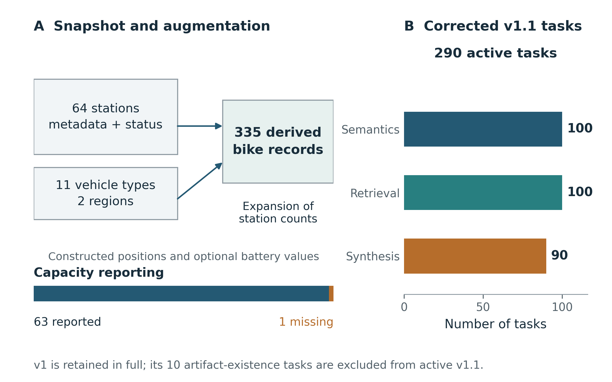
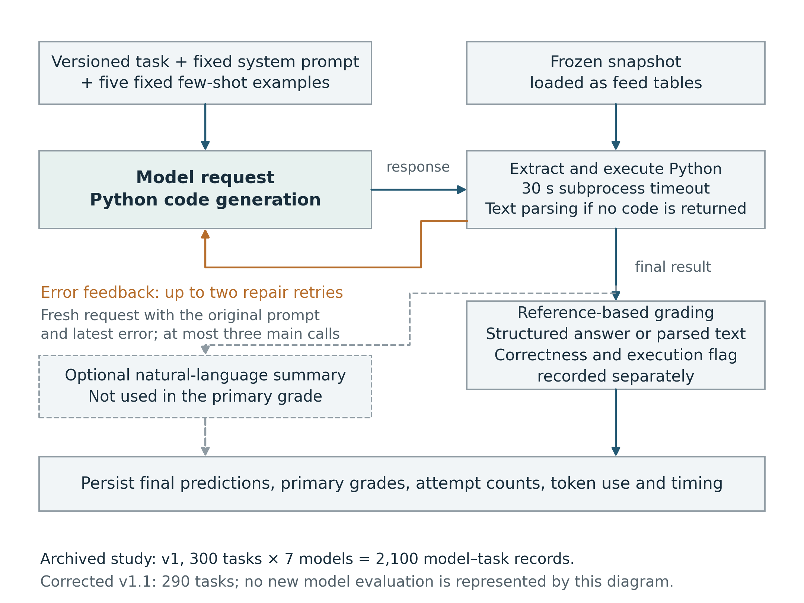

# GBFSBench and BikeshareGPT

**GBFSBench MV-Rad v1.1** contains 290 tasks: 100 GBFS semantics, 100 snapshot retrieval and 90 executable synthesis tasks. BikeshareGPT prompts a model with fixed examples, executes generated Python with bounded repair retries, and grades structured answers.

The corrected release fixes two unsupported targets and 25 ambiguous questions, balances semantics answers to 25 per option, and retires ten plotting tasks whose file-existence metric could not establish chart correctness. The original 300-task v1 bundle and its seven-model study (2,100 records) remain unchanged. **No new model evaluation has been run on v1.1.**

Read the [data card](DATA_CARD.md), [evaluation protocol](REPRODUCIBILITY.md), [release notes](docs/releases/v1.1.md) and [validation evidence](validation/v1_1/README.md).

Queries and reference answers were constructed together. For data-dependent questions, LLM-generated reference programs were executed on the frozen snapshot to calculate deterministic answers. Evaluated models receive each question, the data interface and five fixed code examples; the item-specific reference programs and expected answers are withheld from their prompts. The task is to produce executable code that reproduces the reference result. This construction account was confirmed by the author on 20 November 2026; the complete original program archive remains unrecovered. See [reference-answer methods](docs/reference_answers.md) and the [dated provenance update](validation/PROVENANCE.md#author-confirmation-on-20-november-2026).

## Validate offline

From the repository root with Python 3.10 or newer:

```bash
python scripts/build_v1_1.py --check
python scripts/validate_v1_1.py
python scripts/reconstruct_derived_bikes.py --check
python scripts/audit_release.py
```

The corrected reference report has **290/290 matching references and 369/369 checks**. This combines source-grounded Astra-assisted review and independent Python recalculation; it is not independent human annotation. The original reference audit remains in [validation/](validation/README.md).

For pinned official GBFS 2.3 schemas:

```bash
python -m pip install -r validation/schema_requirements.txt
python scripts/validate_v1_1_schema.py
```

Nine of ten v1.1 payloads pass their individual schemas. The remaining local discovery document deliberately uses relative file URLs; there are zero unexpected failures. This does not establish complete cross-file GBFS conformance.

## Contents

| Path | Contents |
| --- | --- |
| `benchmarks/gbfs_mv_rad_v1_1/` | Current tasks, normalized snapshot, migration and validation evidence |
| `benchmarks/gbfs_mv_rad_v1/` | Unchanged original 300-task dataset |
| `outputs/shared/`, `outputs/models/` | Unchanged original inputs and seven-model outputs |
| `data/few_shot_gbfs_v1_1.yaml` | Five examples for the corrected protocol |
| `data/few_shot_gbfs.yaml` | Preserved historical examples |
| `bikesharegpt/` | Loaders, prompts, runner, executor and graders |
| `configs/mv_rad_v1_1_suite.yaml` | Configuration for a future corrected-release run |
| `paper/figures/` | Scientific figures, captions, source hashes and plotting data |
| `tests/`, `scripts/`, `validation/` | Offline regressions, builders and validation |
| `benchmarks/gbfs_bench_v1/`, `data/toy_snapshot/` | Separate example bundles, not additional evaluated operators |

## Data and framework figures





The [figure package](paper/README.md) also includes station geography and availability, plus PDF/SVG versions for publication. These figures explain the data and implementation; they are separate from retired LLM visualization tasks.

## Run v1.1

Install dependencies, copy `.env.example` to `.env`, and configure the chosen providers. This command invokes external model APIs and may incur charges:

```bash
python -m pip install -r requirements.txt
python -m bikesharegpt.cli --config configs/mv_rad_v1_1_suite.yaml
```

The CLI default and `./run.sh` use v1.1. The suite retains Gemma 3 (4B/12B/27B), Ministral 3 (3B/8B/14B) and GPT-5 provider aliases; availability and revisions may differ from the historical study. Original configurations remain available.

New runs use `outputs/mv_rad_v1_1_gemma_ministral_gpt5_suite/`. A fingerprint prevents resuming after changes to inputs, configuration, prompts, code, recorded dependencies or effective API endpoints. Use a fresh run name after protocol changes. Optional GPT-5 sanity adjudication is off unless `BSGPT_SANITY_MAX_CHECKS` is positive.

## Offline tests

```bash
python -m pip install pytest
python -m pytest -q tests
```

The 47 tests use fake clients and require no API keys. Execution uses a timeout-controlled Python subprocess, not an operating-system security sandbox.

## Scope and release metadata

The frozen source contains 64 stations, 11 vehicle types and two regions. Its 335 vehicle rows are derived representations of station bikes, not additional independently observed vehicles. Endpoint updates span 28 February 2026, 12:47:24–12:53:26 UTC; these are feed timestamps, not verified download times. Reconstruction reproduces the retained rows exactly, but historical acquisition logs and construction code remain unrecovered. Coverage is one operator and one snapshot.

Software is MIT; source metadata declares CC0-1.0. The author confirmed retaining the existing research-use and attribution terms for authored tasks and derived rows on 20 November 2026. No replacement license is introduced. The data are publicly available in the [pinned v1.1 repository snapshot](https://github.com/jtzach/BikeshareGPT/tree/3f69fb4b0d2fcf9ee1860ff0e6d2b836150db223/benchmarks/gbfs_mv_rad_v1_1); no archival DOI is currently assigned.
